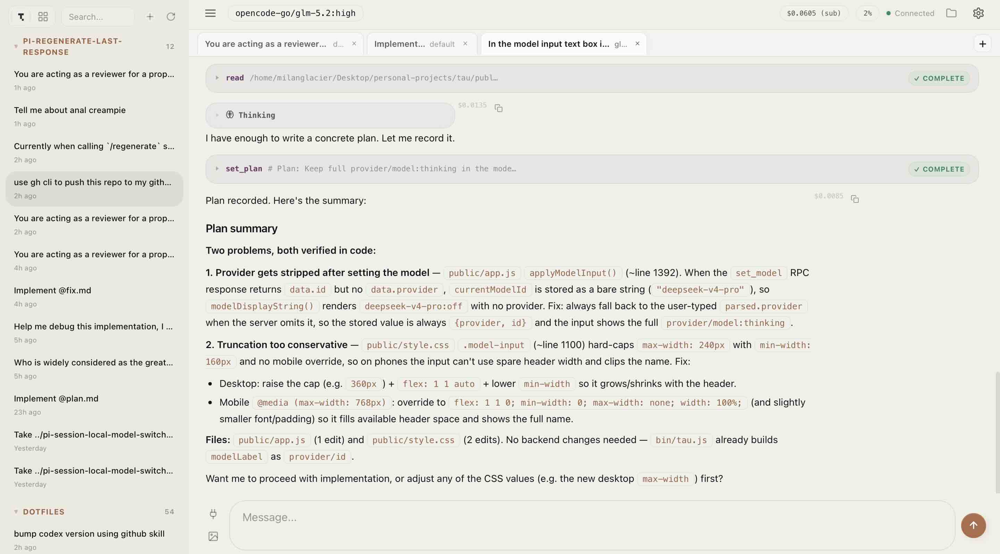
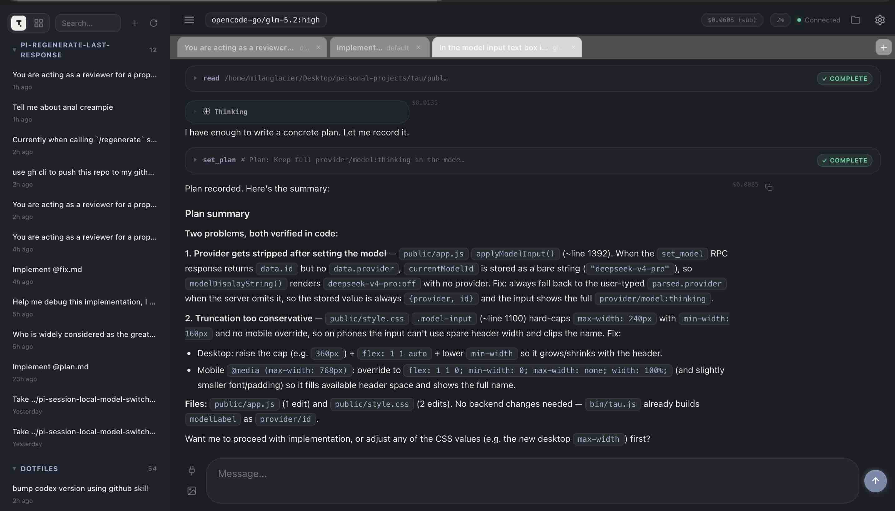
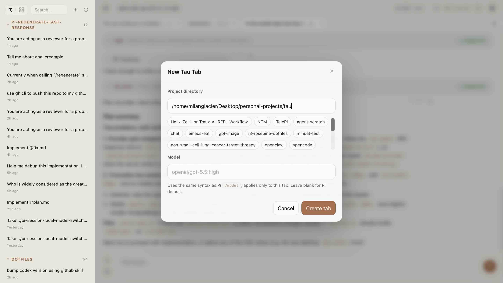
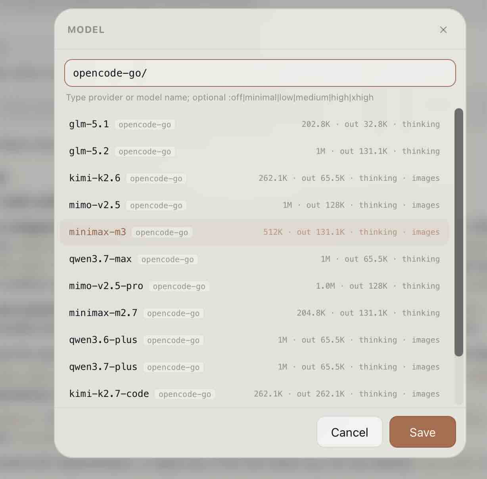
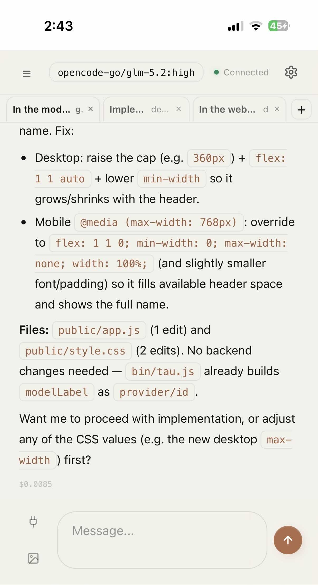
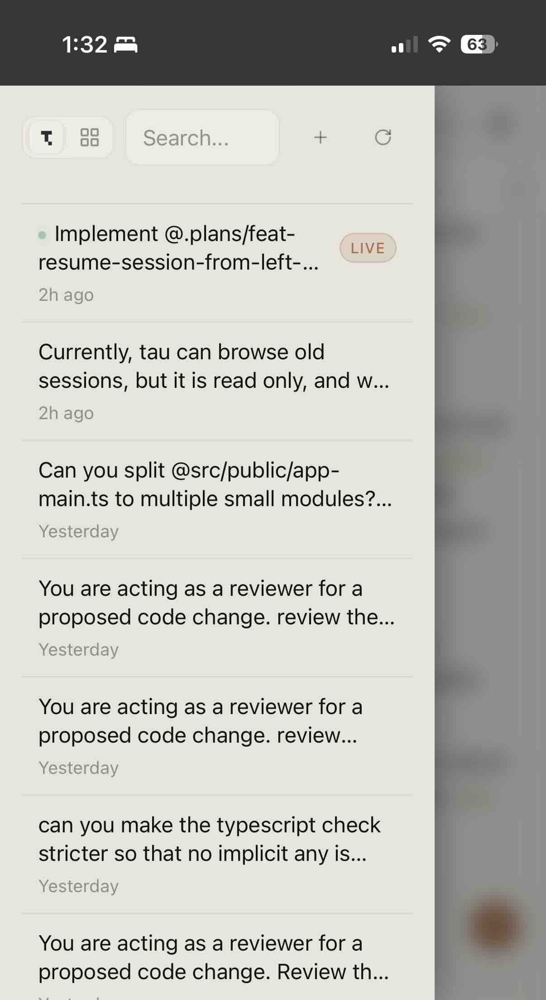

# Pi Tau Web Server

**Browser workspace for [Pi](https://github.com/earendil-works/pi) — a standalone web server that manages multiple live Pi RPC sessions in parallel.**

Pi Tau Web Server is a fork of [deflating/tau](https://github.com/deflating/tau), forked at
[`5e2bce39`](https://github.com/deflating/tau/tree/5e2bce39) and rewritten from
a Pi extension that ran inside the Pi TUI into a standalone Node.js web server.
The original Tau project was retired on 2026-09-30 and is no longer maintained.
This fork is under active maintenance and development. Instead of living inside
a TUI session, Tau runs one backend process and spawns headless `pi --mode rpc`
child processes — one per in-page Tau tab — so you can work with multiple Pi
sessions side by side in your browser.

## Key differences from `5e2bce39`

| Area                  | Upstream (`5e2bce39`)                                                                         | This fork                                                                                                      |
| --------------------- | --------------------------------------------------------------------------------------------- | -------------------------------------------------------------------------------------------------------------- |
| **Architecture**      | Pi extension loaded inside the Pi TUI process; browser displayed a single running TUI session | Standalone Node.js server that spawns independent `pi --mode rpc` child processes                              |
| **Multiple sessions** | Not supported                                                                                 | In-page tabs each backed by their own Pi RPC subprocess; run N sessions in parallel                            |
| **Session lifecycle** | Tied to the Pi TUI session — close the TUI and the browser view died                          | Sessions are server-owned; closing/reloading the browser does not kill Pi children                             |
| **Pi communication**  | In-process Pi extension API                                                                   | Out-of-process JSON line-delimited RPC over stdin/stdout                                                       |
| **UI dialogs**        | `ctx.ui.confirm/input/select` shown in TUI only; not forwarded to the browser                 | All forwarded to the browser — extensions that use these built-in UI interfaces work seamlessly in the browser |
| **Test coverage**     | Javascript and No tests                                                                       | Typescript + Full test suite                                                                                   |
| **Auto-start**           | Extension auto-started inside Pi unless `TAU_DISABLED=1`                                      | Always explicit — the user runs `pi-tau-web-server` when they want it                                          |
| **Various enhancements** | N/A                                                                                           | Session tree and branching, mirroring Pi TUI's `/tree` command                                                  |















## What it does

- **Standalone server** — run `pi-tau-web-server` and open the page; you get a full Pi workspace without the TUI.
- **Multiple live sessions** — each in-page Tau tab is an independent Pi session. Create and close them from one page, and all of them run in parallel.
- **Sidebar and tab bar** — browse every session in the sidebar the way a traditional agent app does, and use the tab bar to switch between the ones you have open. On mobile the tab bar stays visible while the sidebar slides over the page, so switching sessions does not cost you chat space.
- **Sessions stay alive** — closing or reloading the browser does not end them. A session stops when you close its tab or stop the server.
- **Works on any device** — open the same Tau server from your phone, tablet, or another monitor.
- **Session history** — browse saved Pi sessions and search across all of them by message content.

## Install

Requires Node.js 22.19 or newer and [Pi](https://github.com/earendil-works/pi)
installed as the `pi` command on your `PATH`.

```bash
npm install --global pi-tau-web-server
```

## Usage

```bash
pi-tau-web-server
```

Open the printed URL (default `http://localhost:3001`). Click `+` in the tab bar
or sidebar, choose or type a project directory, optionally enter a model in Pi's
`/model` format, and start chatting.

```bash
pi-tau-web-server --host 127.0.0.1 --port 3001 --open
TAU_PORT=3001 TAU_HOST=0.0.0.0 TAU_PROJECTS_DIR="$HOME/projects" pi-tau-web-server
```

## Containers

The container launcher runs one isolated Tau service per instance name. Docker
and Podman are supported; set `TAU_CONTAINER_RUNTIME` to select one explicitly.
The image builds automatically on the first run, or you can build it ahead of
time:

```bash
container/tau-container build
```

Start an instance with credentials in the environment:

```bash
TAU_USER=alice TAU_PASS='choose-a-password' \
  container/tau-container run personal-workspace --port 3001
```

If credentials are missing, the launcher prompts for them and hides the password
input. Start additional isolated instances by giving each one a different name
and host port:

```bash
container/tau-container run work-workspace --port 3002
container/tau-container status
container/tau-container logs work-workspace
container/tau-container stop work-workspace
```

Each instance has its own projects directory at `~/projects` inside the
container, mounted read-write from the instance's `projects/` state directory.

On first launch, the launcher copies your Pi configuration from
`${PI_CODING_AGENT_DIR:-$HOME/.pi/agent}` into the instance's writable state.
The copy leaves out saved sessions, installed packages, and git checkouts, so Pi
installs any packages it needs the first time a session starts. Symlinks are
followed during the copy.

The copied configuration never refreshes automatically. Changes that Pi or Tau
make to it survive container recreation and stay isolated from other instances.
Projects and session files are also stored separately per instance. By default,
state is kept under:

```text
${XDG_DATA_HOME:-$HOME/.local/share}/pi-tau-web-server/instances/<instance>/
```

The host-side projects directory is `<instance>/projects/` beneath that path.
Override the state root with `TAU_CONTAINER_STATE_DIR`.

Ports bind to all host interfaces by default. HTTP Basic Auth encrypts neither
credentials nor traffic, so use a TLS reverse proxy when accessing Tau from
another machine. Pass `--bind 127.0.0.1` to the launcher to restrict an instance
to local access.

## Features

### Chat

- Full markdown rendering with syntax-highlighted code blocks
- Streaming responses with typing indicator
- Image attachments (paste, drag & drop, or button)
- Copy any message with one click
- Inline diff viewer for edit tool calls
- Message queuing while the agent is working

### Live session management

- Each in-page Tau tab is a live Pi session, and all tabs run in parallel
- **Sidebar and tab bar** — browse sessions in the sidebar, as in a traditional agent app, and use the tab bar to see and switch between the sessions you have open. On mobile, the sidebar slides over the page while the tab bar stays visible, so you can switch sessions without giving up chat space.
- Reloading or reconnecting restores your live tabs
- Multiple browser clients see the same live sessions
- Historical sessions remain read-only
- **Session tree and branching** — inspect the active session's full tree and jump to any earlier entry, mirroring Pi TUI's `/tree` behavior; choose a user message to restore it to the composer and create a new branch

### Model and thinking

- Optional model string at session creation using Pi `/model` syntax (e.g. `openai/gpt-5.5:high`)
- Per-session model picker with fuzzy search
- Per-session thinking level controls
- Token usage percentage with context window visualisation
- Cost tracking per session

### File browser

- Right sidebar rooted at the active live session's working directory
- Navigate directories and open files natively
- Drag files onto the input to insert their path

### Session browser

- Sidebar with all saved Pi sessions, grouped by project
- Full-text search across all historical sessions with highlighted snippets
- Rename sessions and export them to HTML

### Mobile support

- Slide-over sidebar with swipe-from-edge gesture
- Slimmed header with the model picker still accessible
- Larger touch targets and font sizes on small screens
- Automatic reconnection when you return to the app
- PWA: installable as a standalone app on iOS, Android, and macOS

### Themes

Six built-in themes: Dusk (clean neutral dark, default), Dawn (warm blue dark),
Midnight (OLED black), Clean (Apple-style light with cyan-blue accents),
Terracotta (warm light), and Sage (cool green light). All use a frosted-glass
header and input area.

## Configuration

### CLI flags

| Flag | Description |
| --- | --- |
| `--open` | Open the URL in the default browser on start |
| `--port` / `TAU_PORT` | Server port (default: `3001`) |
| `--host` / `TAU_HOST` | Bind address (default: `0.0.0.0`) |
| `--projects-dir` / `TAU_PROJECTS_DIR` | Directory offered as a project shortcut in the new-session dialog and used as the base for relative paths typed in the project field |
| `--pi-command` / `TAU_PI_COMMAND` | Pi executable that Tau runs (default: `pi`) |

### Environment variables

| Variable | Default | Description |
| --- | --- | --- |
| `TAU_PORT` | `3001` | Server port |
| `TAU_HOST` | `0.0.0.0` | Bind address |
| `TAU_PROJECTS_DIR` | _(none)_ | Directory offered as a project shortcut in the new-session dialog |
| `TAU_PI_COMMAND` | `pi` | Pi executable that Tau runs |
| `TAU_STATIC_DIR` | _(bundled)_ | Directory that holds the web UI files |
| `TAU_USER` | _(none)_ | HTTP Basic Auth username |
| `TAU_PASS` | _(none)_ | HTTP Basic Auth password |
| `TAU_COOKIE_SECRET` | _(generated)_ | Secret used to sign login cookies |

The same settings can also live in `~/.pi/agent/settings.json` under the `tau`
key: `host`, `port`, `projectsDir`, `user`, `pass`, `authEnabled`, and
`cookieSecret`.

### Using a different Pi command

To run a Pi fork or wrapper instead of `pi`, pass `--pi-command` or set
`TAU_PI_COMMAND`; the flag wins. The value must be a single executable with no
arguments. If the fork keeps its configuration outside `~/.pi/agent`, set
`PI_CODING_AGENT_DIR` as well.

```bash
pi-tau-web-server --pi-command pi-bolt
```

### Authentication

Tau can require HTTP Basic authentication. Set credentials in
`~/.pi/agent/settings.json` or with environment variables, then turn on
"Require login" in Tau Settings.

```json
{
  "tau": {
    "user": "pi",
    "pass": "your-password"
  }
}
```

When login is on, every page and API request requires credentials.
`/api/health` stays open for monitoring.

After the first successful login, Tau signs the browser in so you do not have to
enter the password again. This matters on mobile: iOS Safari and the installed
PWA forget the saved login when you switch apps, so without it you would be
prompted every time you came back. The login lasts for the browser session. It
expires after 12 hours of inactivity and renews while you use the app. Changing
the password signs out every device. Removing the generated `cookieSecret` from
settings and restarting Tau also signs out every device.

## Development

### Prerequisites

- [Pi](https://github.com/earendil-works/pi) must be installed (`pi` on `PATH`)
- Node.js and npm

To run Tau from a checkout:

```bash
npm install
npm run build
node bin/tau.js
```

## License

MIT
